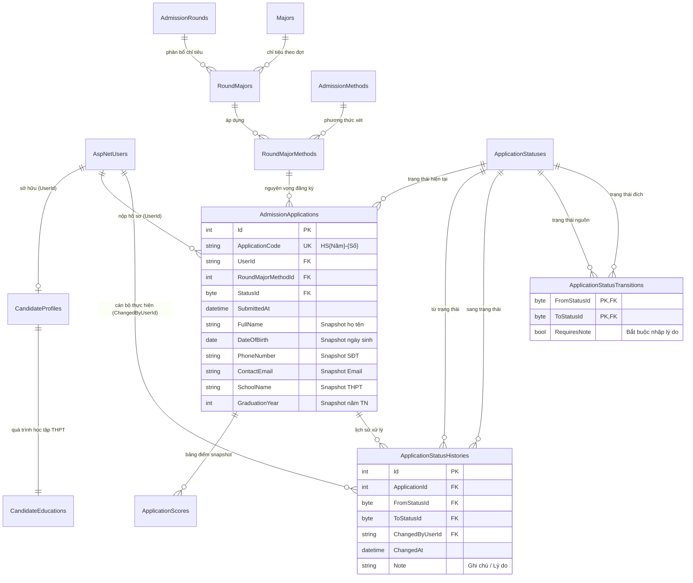

# CNPM-NHOM4 - TuyenSinhOnline
# HỆ THỐNG QUẢN LÝ TUYỂN SINH TRỰC TUYẾN

> **Đồ án môn Công nghệ phần mềm — Nhóm 4**  
> **Giảng viên hướng dẫn:** TS. Cao Thanh Sơn — Trường Đại học Vinh  
> **Phiên bản hoàn thiện:** Hoàn tất toàn diện 4 Sprint (Sprint 1, 2, 3, 4)

---

## 1. Giới thiệu tổng quan & Phạm vi 8 nhóm chức năng (4 Sprint)

Hệ thống **TuyenSinhOnline** là giải pháp phần mềm hiện đại hóa toàn diện công tác tuyển sinh đại học trực tuyến: từ khâu công bố kế hoạch chỉ tiêu, tiếp nhận đăng ký xét tuyển, xét duyệt hồ sơ theo máy trạng thái chuẩn, quản trị hồ sơ đến thống kê tuyển sinh đa chiều.

Dự án được xây dựng và nghiệm thu theo mô hình Agile/Scrum qua 4 Sprint bao phủ trọn vẹn 8 nhóm chức năng cốt lõi:

* **Sprint 1 (Nền tảng & Cấu hình tuyển sinh):**
  - **F1. Xác thực & Phân quyền:** Phân quyền 3 vai trò độc lập: `QuanTriHeThong` (Admin), `CanBoTuyenSinh` (Cán bộ), `ThiSinh` (Thí sinh).
  - **F2. Quản lý danh mục tuyển sinh:** Quản lý Ngành học (`/Majors`), Phương thức (`/AdmissionMethods`), Đợt tuyển sinh (`/AdmissionRounds`).
  - **F3. Phân bổ chỉ tiêu & Áp dụng phương thức:** Cấu hình chỉ tiêu ngành theo đợt và liên kết phương thức xét tuyển (`/Quotas`).
* **Sprint 2 (Cổng thí sinh & Hồ sơ cá nhân):**
  - **F4. Cổng tra cứu thí sinh:** Cổng thông tin tra cứu kế hoạch tuyển sinh theo đợt thời gian thực (`/Candidate`).
  - **F5. Hồ sơ cá nhân & Học bạ THPT:** Khai báo và chuẩn hóa lý lịch, quá trình học tập cấp THPT (`/CandidateProfile`).
* **Sprint 3 (Đăng ký xét tuyển & Bảo vệ dữ liệu):**
  - **F6. Nộp hồ sơ xét tuyển trực tuyến:** Kiểm tra điều kiện nộp và khung giờ nhận hồ sơ phía máy chủ, lưu **Snapshot bất biến** thông tin cá nhân và điểm xét tuyển tại thời điểm nộp, sinh mã hồ sơ duy nhất dạng `HS{Năm}-{6 số}`, bảo vệ chống nộp lặp 3 lớp (`/ApplicationForm/Create`).
  - **F7. Theo dõi hồ sơ & Phòng thủ IDOR:** Danh sách hồ sơ đã nộp, xem chi tiết snapshot, bảo mật chống truy cập trái phép **IDOR** tuyệt đối giữa các thí sinh (`/ApplicationForm`).
* **Sprint 4 (Xét duyệt hồ sơ, Lịch sử & Thống kê đa chiều):**
  - **F8. Xử lý hồ sơ, Lịch sử máy trạng thái & Thống kê tuyển sinh:**
    * **S4-01 & S4-03:** Máy trạng thái 5 bước (`Pending -> InReview -> NeedsSupplement -> InReview -> Approved/Rejected`), bọc cập nhật trạng thái và ghi lịch sử trong cùng `Database Transaction`, chống ghi đè trạng thái đa luồng (`Concurrency Check`), bắt buộc lý do khi bổ sung/từ chối.
    * **S4-02:** Màn hình cán bộ tra cứu, tìm kiếm kết hợp lọc hồ sơ đa điều kiện (`/StaffApplications`).
    * **S4-04:** Thí sinh theo dõi trạng thái và dòng thời gian xử lý, **tuyệt đối ẩn ghi chú nội bộ** của cán bộ, chỉ hiển thị lý do công khai khi cần bổ sung hoặc từ chối.
    * **S4-05 & S4-06:** Module Thống kê tuyển sinh (`/StaffApplications/Statistics`) truy vấn EF Core **chống đếm trùng 100%**, luôn hiển thị đủ 5 trạng thái (kể cả số lượng = 0), biểu đồ tỷ lệ % trực quan theo Ngành, Phương thức và Trạng thái.

---

## 2. Công nghệ sử dụng & Môi trường yêu cầu

* **Framework backend:** .NET 9 SDK (C# 13, ASP.NET Core MVC 9.0).
* **Cơ sở dữ liệu & ORM:** Microsoft SQL Server 2019/2022 hoặc LocalDB (`(localdb)\MSSQLLocalDB` / `(localdb)\TuyenSinhOnlineDev`), Entity Framework Core 9.0.
* **Xác thực & Bảo mật:** ASP.NET Core Identity (mã hóa mật khẩu an toàn, Rate Limiter chống brute-force, `AutoValidateAntiforgeryTokenAttribute` chống CSRF, chống IDOR, Parameterized SQL chống Injection).
* **Giao diện người dùng:** Razor Views (HTML5 Semantic, CSS responsive thuần tối ưu hiệu năng không phụ thuộc thư viện nặng, Vanilla JavaScript).

---

## 3. Sơ đồ thực thể quan hệ cơ sở dữ liệu (ERD Mermaid)

Sơ đồ thể hiện 100% cấu trúc quan hệ thực tế trong [ApplicationDbContext.cs](file:///d:/2026_2027/CNPM/Web/src/TuyenSinhOnline/Data/ApplicationDbContext.cs):



---

## 4. Hướng dẫn cài đặt & Khởi chạy Website từ đầu

### Bước 1: Cấu hình chuỗi kết nối Database
Tệp `src/TuyenSinhOnline/appsettings.json` mặc định trỏ tới SQL Server cục bộ:
```json
"ConnectionStrings": {
  "DefaultConnection": "Server=.;Database=CNPM;Trusted_Connection=True;TrustServerCertificate=True"
}
```
*(Nếu dùng SQL Express hoặc LocalDB, chỉ cần đổi `Server=.\SQLEXPRESS` hoặc `Server=(localdb)\MSSQLLocalDB`)*.

### Bước 2: Cập nhật CSDL (EF Core Migrations)
Dự án áp dụng đầy đủ chuỗi migration từ Sprint 1 đến Sprint 4:
```powershell
dotnet ef database update --project src/TuyenSinhOnline/TuyenSinhOnline.csproj
```

### Bước 3: Khởi chạy website bằng Script tự động
```powershell
powershell -ExecutionPolicy Bypass -File .\scripts\Start-Website.ps1
```
* **Địa chỉ truy cập:** `http://localhost:5080` (hoặc `https://localhost:7080`).
* Mật khẩu demo chung được tạo ngẫu nhiên và lưu an toàn tại `.local/demo-password.txt`.

### Danh sách tài khoản demo hệ thống:
| Vai trò | Email đăng nhập | Mật khẩu | Mục đích sử dụng trình diễn |
| :--- | :--- | :---: | :--- |
| **Quản trị viên** | `admin.demo@tuyensinh.local` | Trong `.local/demo-password.txt` | Cấu hình ngành, phương thức, đợt, chỉ tiêu và xem Thống kê tuyển sinh. |
| **Cán bộ tuyển sinh** | `canbo.demo@tuyensinh.local` | Trong `.local/demo-password.txt` | Tra cứu, duyệt hồ sơ, yêu cầu bổ sung, xem lịch sử và Thống kê tuyển sinh. |
| **Thí sinh 1** | `thisinh.demo@tuyensinh.local` | Trong `.local/demo-password.txt` | Đã có lý lịch + học bạ + 3 hồ sơ nộp ở các trạng thái (Đã duyệt, Chờ tiếp nhận, Cần bổ sung). |
| **Thí sinh 2** | `thisinh2.demo@tuyensinh.local` | Trong `.local/demo-password.txt` | Tài khoản mới chưa có hồ sơ $\rightarrow$ Demo rào chắn điều kiện và kiểm chứng chống IDOR. |
